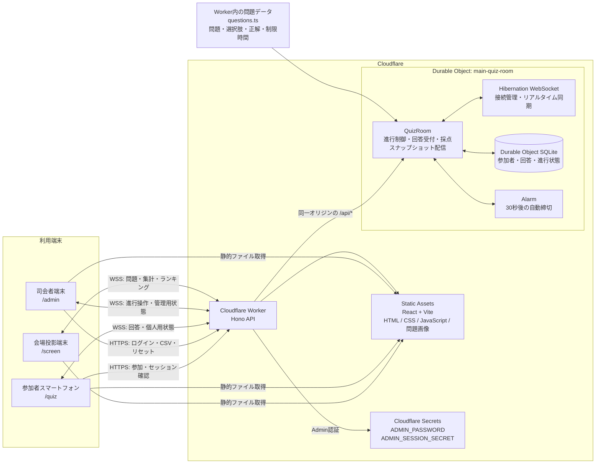
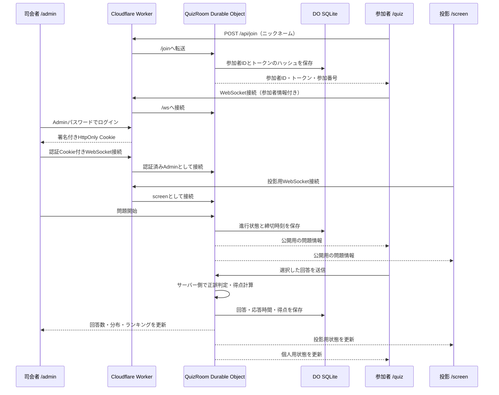
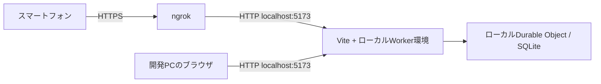

# 現在のアーキテクチャ

## 全体構成図

## リクエストの流れ

## コンポーネントの役割

| コンポーネント | 現在の役割 |
| --- | --- |
| Reactクライアント | `/quiz`、`/admin`、`/screen` の3画面を提供 |
| Cloudflare Worker / Hono | APIルーティング、Admin認証、Static Assets配信、Durable Objectへの中継 |
| `QuizRoom` Durable Object | 1大会の状態を1か所で直列に処理し、回答・進行の競合を防止 |
| Hibernation WebSocket | 各端末へ状態をリアルタイム配信し、切断時はクライアントが再接続 |
| Durable Object SQLite | `participants`、`answers`、`quiz_state` を永続化 |
| Durable Object Alarm | 問題開始時に締切時刻を登録し、制限時間後に自動締切 |
| `questions.ts` | 問題、選択肢、正解、制限時間をWorker側に保持 |
| Cloudflare Secrets | AdminパスワードとCookie署名鍵をGitHub外で管理 |

## セキュリティと公開範囲

- ブラウザへ送る問題データには、正解発表前の `correctChoice` を含めない。
- 正誤判定と得点計算はDurable Object内で行う。
- Admin APIとAdmin WebSocketは署名付きHttpOnly Cookieで認証する。
- 参加者トークンはブラウザのローカルストレージに保存し、サーバー側にはSHA-256ハッシュを保存する。
- 投影画面には操作権限を与えず、公開可能な状態だけを配信する。
- リセット時はSQLite内の参加者・回答を削除し、接続中の参加者へセッション削除を通知する。

## 現在使用していないサービス

D1、KV、R2、Queuesは使用していません。問題画像はStatic Assets、イベント状態と回答は1個のSQLite-backed Durable Objectで管理しています。

## ローカル開発時

ローカルではViteとCloudflare開発環境を `npm run dev` で起動します。スマートフォンから確認するときだけngrokを手前に置きます。

